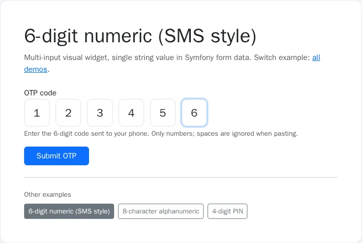

# OTP Input Bundle

[](https://github.com/nowo-tech/OTPInputBundle/actions/workflows/ci.yml) [](https://packagist.org/packages/nowo-tech/otp-input-bundle) [](https://packagist.org/packages/nowo-tech/otp-input-bundle) [](LICENSE) [](https://php.net) [](https://symfony.com) [](https://github.com/nowo-tech/OTPInputBundle) [](#tests-and-coverage)

> Star **Found this useful?** Install it from Packagist and support the project on GitHub.

Customizable Symfony OTP `FormType` with multiple visible inputs that map to a single field value.


This bundle is **FrankenPHP worker mode friendly**.

## Table of contents

- [Features](#features)
- [Quick usage](#quick-usage)
- [Demo preview](#demo-preview)
- [Documentation](#documentation)
- [Tests and coverage](#tests-and-coverage)

## Features

- `OtpType::class` for verification codes (2FA, email confirmation, magic code).
- Multi-input UI rendered in Twig form themes.
- Stores data as one string value in your DTO/entity.
- Customizable length, classes, numeric/alphanumeric mode, and uppercase normalization.
- TypeScript + Vite assets in `src/Resources/assets` (named package `nowo_otp_input`).
- Paste / SMS autofill (`autocomplete="one-time-code"` on the first box); translations **de, en, es, fr, it, nl, pt**.
- Multi-framework Twig themes (Bootstrap, Tailwind, Foundation, Symfony default).
- FrankenPHP worker mode verified with `FRANKENPHP_RESET_KERNEL=false` (sticky Kernel); see the [worker audit](docs/FRANKENPHP-WORKER-AUDIT.md).

## Quick usage

```php
use Nowo\OtpInputBundle\Form\OtpType;

$builder->add('otpCode', OtpType::class, [
    'length' => 6,
    'numeric_only' => true,
    'container_class' => 'd-flex gap-2',
    'input_class' => 'form-control text-center',
    'gap_class' => 'otp-grid',
]);
```

The value received in `otpCode` is a single string like `123456`.

## Demo preview

<table>
  <tr>
    <td align="center" width="50%">
      
      <br /><sub>Empty OTP digit cells</sub>
    </td>
    <td align="center" width="50%">
      
      <br /><sub>Code entered across digit cells</sub>
    </td>
  </tr>
</table>

## Documentation

- [Installation](docs/INSTALLATION.md)
- [Configuration](docs/CONFIGURATION.md)
- [Usage](docs/USAGE.md)
- [Contributing](docs/CONTRIBUTING.md)
- [Code of Conduct](CODE_OF_CONDUCT.md)
- [Changelog](docs/CHANGELOG.md)
- [Upgrading](docs/UPGRADING.md)
- [Release](docs/RELEASE.md)
- [Security](docs/SECURITY.md)
- [Engram](docs/ENGRAM.md)
- [Spec-driven development](docs/SPEC-DRIVEN-DEVELOPMENT.md)
- [GitHub Spec Kit](docs/SPEC-KIT.md)

### Additional documentation

- [GitHub Actions CI requirements](docs/GITHUB_CI.md)
- [PSR evaluation (REQ-CS-007)](docs/PSR.md)
- [FrankenPHP worker audit (`reset_kernel: false`)](docs/FRANKENPHP-WORKER-AUDIT.md)
- [Demo notes](docs/DEMO-FRANKENPHP.md)

## Tests and coverage

- PHP: 100%
- TS/JS: 97.33% (Vitest; lowest of statements/branches/functions/lines — lines 100%, branches 97.33%; CI gate 90%)
- Python: N/A
