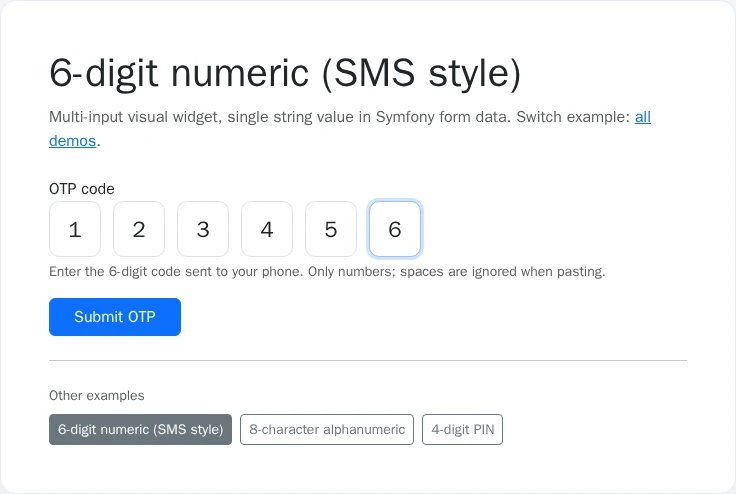

# Usage

## Screenshots

| Overview | Interaction |
|----------|-------------|
|  |  |

Regenerate with `make -C demo/symfony8 demo-screenshots` (REQ-DEMO-013).


## Table of contents

- [Screenshots](#screenshots)

- [Form type](#form-type)
- [Frontend script](#frontend-script)
- [Customization](#customization)
- [Using it from a DDD / hexagonal application](#using-it-from-a-ddd--hexagonal-application)
- [Twig template overrides](#twig-template-overrides)

## Form type

Use `OtpType` in any Symfony form:

```php
use Nowo\OtpInputBundle\Form\OtpType;

$builder->add('otpCode', OtpType::class, [
    'length' => 6,
    'numeric_only' => true,
    'uppercase' => true,
    'container_class' => 'd-flex gap-2',
    'input_class' => 'form-control text-center',
    'gap_class' => 'otp-input-grid',
    'placeholder_char' => '•',
]);
```

The field value is a single string, for example `123456`.

`placeholder_char` (default `''`) is rendered as the `placeholder` attribute of every box.

Autofill: only the first box has `autocomplete="one-time-code"` (and no `maxlength`), so iOS/Android SMS code suggestions fill the first box with the whole code; the script then spreads it across all boxes. Custom themes that override `nowo_otp_input_widget` should keep this pattern.

## Frontend script

Include the built OTP script in your layout (after `assets:install`):

```twig
<script src="{{ asset('otp-input.js', 'nowo_otp_input') }}"></script>
```

The `nowo_otp_input` package maps to `/bundles/nowootpinput` (the path created by `assets:install`).

The script defines the `<nowo-otp-input>` custom element (light DOM: hidden Symfony input + visible digit boxes) and still initializes legacy `[data-nowo-otp-container="1"]` wrappers.

## Customization

- `length`: number of OTP characters (3-12)
- `numeric_only`: only digits when true
- `uppercase`: normalize alpha chars to uppercase
- `container_class`, `input_class`, `gap_class`: full CSS control
- `autofocus`: autofocus first OTP digit

## Using it from a DDD / hexagonal application

`OtpType` is a **presentation** component: a form field that renders N boxes and submits one normalized string. It has
no entities, no Doctrine mapping, no events, and it does not generate, send or verify codes. Your domain never
depends on the bundle.

- Bind the field to a string property of your form DTO or command (for example `VerifyLoginCode::$code`); the value is
  digits only (or `A-Z0-9` with `numeric_only: false`), uppercased with `uppercase: true`, and at most `length`
  characters.
- Generating, storing, rate-limiting and verifying the code stays in your application/domain (or in your 2FA library).
- The bundle does not enforce the minimum length: add the constraint on your DTO.

```php
use Symfony\Component\Validator\Constraints as Assert;

final class VerifyLoginCode
{
    #[Assert\NotBlank]
    #[Assert\Length(exactly: 6)]
    public string $code = '';
}
```

If you want a domain value object instead of a string, add your own model transformer to the field; it runs after the
bundle's one:

```php
$builder->add('code', OtpType::class, ['length' => 6]);
$builder->get('code')->addModelTransformer(new CallbackTransformer(
    static fn (?OneTimeCode $code): string => $code?->value() ?? '',
    static fn (string $code): ?OneTimeCode => '' === $code ? null : new OneTimeCode($code),
));
```

Known limitations: a code shorter than `length` is not rejected by the field itself.

## Twig template overrides

The bundle registers its Twig views so that `@NowoOtpInputBundle/...` works, and it adds its view path **after** the application paths. Overrides under **`templates/bundles/NowoOtpInputBundle/`** are therefore checked first. Place a file there with the **same relative path** as in the bundle; Twig will use your template instead of the bundle’s.

Use the directory name **`NowoOtpInputBundle`** (matches `Bundle::getName()`).

| Bundle path under `src/Resources/views/` | Application override |
| ---------------------------------------- | -------------------- |
| `Form/otp_input_theme.html.twig` | `templates/bundles/NowoOtpInputBundle/Form/otp_input_theme.html.twig` |
| `Form/otp_input_theme_table.html.twig` | `templates/bundles/NowoOtpInputBundle/Form/otp_input_theme_table.html.twig` |
| `Form/otp_input_theme_bootstrap5.html.twig` | `templates/bundles/NowoOtpInputBundle/Form/otp_input_theme_bootstrap5.html.twig` |
| `Form/otp_input_theme_bootstrap5_horizontal.html.twig` | `templates/bundles/NowoOtpInputBundle/Form/otp_input_theme_bootstrap5_horizontal.html.twig` |
| `Form/otp_input_theme_bootstrap4.html.twig` | `templates/bundles/NowoOtpInputBundle/Form/otp_input_theme_bootstrap4.html.twig` |
| `Form/otp_input_theme_bootstrap4_horizontal.html.twig` | `templates/bundles/NowoOtpInputBundle/Form/otp_input_theme_bootstrap4_horizontal.html.twig` |
| `Form/otp_input_theme_bootstrap3.html.twig` | `templates/bundles/NowoOtpInputBundle/Form/otp_input_theme_bootstrap3.html.twig` |
| `Form/otp_input_theme_bootstrap3_horizontal.html.twig` | `templates/bundles/NowoOtpInputBundle/Form/otp_input_theme_bootstrap3_horizontal.html.twig` |
| `Form/otp_input_theme_foundation5.html.twig` | `templates/bundles/NowoOtpInputBundle/Form/otp_input_theme_foundation5.html.twig` |
| `Form/otp_input_theme_foundation6.html.twig` | `templates/bundles/NowoOtpInputBundle/Form/otp_input_theme_foundation6.html.twig` |
| `Form/otp_input_theme_tailwind2.html.twig` | `templates/bundles/NowoOtpInputBundle/Form/otp_input_theme_tailwind2.html.twig` |

Each file is the form theme for one CSS framework (`otp_input_theme.html.twig` is the framework-neutral default used by `OtpType`; `_table`, `_bootstrap*`, `_foundation*`, `_tailwind2` mirror Symfony's own form themes).

Procedure: copy the vendor file to the override path above (same relative path and filename), clear the cache in dev (`php bin/console cache:clear`), and treat the copy as a fork.

**Override vs upgrade (freeze rule).** An application file at the override path always wins and will not pick up vendor changes for that path until removed or merged. A full-file override is an escape hatch: that `<subpath>` stays frozen on every `composer update` while the rest of the bundle keeps upgrading.

Prefer the upgrade-safe path: the field options (`container_class`, `input_class`, `gap_class`, `length`, `numeric_only`, …), the translations and CSS on the `nowo-otp-*` classes cover most needs without a Twig fork. If you only need different markup for one framework, override that single theme file, not all of them.

**Recovering upstream after a freeze:** delete (or rename aside) the application override, clear the cache (`php bin/console cache:clear`), and re-apply only the customisation you still need. Diff your copy against the new vendor file under `vendor/nowo-tech/otp-input-bundle/src/Resources/views/` before re-copying.

